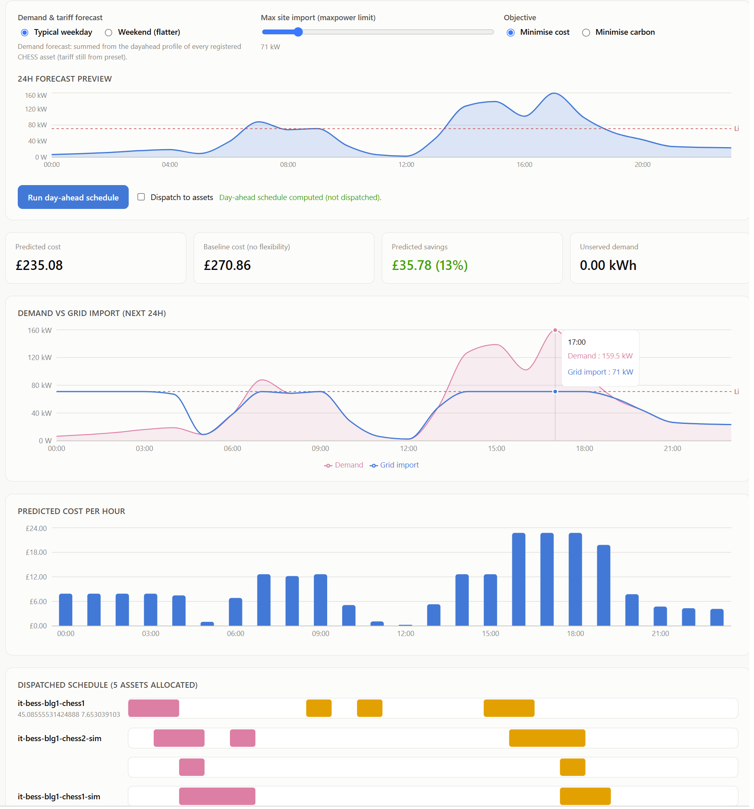

# CHESS Flexibility Dashboard

A React + TypeScript single-page app that visualises a FlexCHESS network's registered
assets, their capabilities, and their flexibility (force-charge/force-discharge/curtail)
schedules, and lets a user select which flexibility windows to offer and preview the
resulting cost/carbon outcome before saving.

It talks to the routes `CHESSNetworkController.cs` exposes in the AAS Server:

| Route | Used for |
|---|---|
| `GET /chess/1.0/capability/{id}` | Capability record per asset (Network & capabilities tab) |
| `GET /chess/1.0/status` | Flexibility status profile for every asset (Flexibility schedule tab) |
| `POST /chess/1.0/status/{id}` | Save an edited set of flexibility windows (Preferences tab) |
| `POST /opt/1.0.0/run` | Preview the cost/carbon-minimising KPI outcome for a proposed set of windows |
| `POST /run/dayahead` | Compute (and optionally dispatch) a next-day cost-minimising schedule (Day-ahead tab) |

## Running

```
npm install
npm run dev
```

Opens on the port Vite chooses (see terminal output). `npm run build` produces a
static `dist/` bundle that can be served from anywhere (e.g. alongside the AAS
Server, or any static host) - it makes no assumption about being co-hosted with
the API.

## Demo vs live data

Settings (top right) has two modes:

- **Demo data** (default) - no backend required. Reads/writes an in-memory copy of
  `src/data/mockData.ts`, and the "Preview optimised outcome" button runs a
  client-side reproduction of the per-priority-level KPI aggregation
  `CHESSNetworkController.runPost` performs server-side, so the UI behaves the
  same either way.
- **Live AAS server** - set the API base URL and an `Authorization` bearer token
  (needs the `saFlexibilityProvider` scope). Because the real API has no "list all
  capabilities" route (only `/status` does), you also list the CHESS ids you want
  the Network tab to show.

Settings persist to `localStorage`.

## Structure

- `src/types.ts` - TypeScript mirrors of the `IoT.Services.Chess*` / `OptionIn`
  digital-twin models.
- `src/api/client.ts` - fetch wrapper for live mode + the demo-mode simulation.
- `src/data/mockData.ts` - the demo CHESS network (battery, EV charger, heat pump).
  The battery and heat pump use `ForceCharge`/`ForceDischarge` windows; the EV
  charger uses `ForceCharge` plus `Curtail` (it curtails charging rather than
  discharging back to the grid).
- `src/components/` - `NetworkOverview`/`AssetDetail` (capabilities),
  `FlexibilityTimeline` (24h Gantt-style schedule view),
  `KpiBreakdownChart` (Recharts bar chart of the optimiser's per-priority-level
  cost/carbon/capacity KPIs), `PreferencesPanel` (the flexibility-selection form),
  `DayAheadPanel` (the day-ahead cost estimate tab).

## Day-ahead tab

Runs the same greedy peak-shaving/replenishment algorithm as
`CHESSNetworkController.runDayAheadPost` + `AllocateDayAhead` against a demand
forecast, a day-ahead tariff curve, and a max site import (`maxpower`) limit:

1. Pick a forecast preset (`src/lib/dayAheadPresets.ts`) and a `maxpower` limit,
   then **Run day-ahead schedule**. This calls `POST /run/dayahead` with
   `Dispatch` set from the "Dispatch to assets" checkbox.
2. Results show predicted vs baseline cost and savings, a demand-vs-grid-import
   chart (with the limit as a reference line), predicted cost per hour, and the
   concrete per-asset schedule the algorithm produced (merged by asset id, since
   the backend can emit one schedule entry per allocated resource).
3. **Run /opt/1.0.0/run on this schedule** feeds that resulting schedule back
   through the per-priority-level KPI optimiser (one call per asset, aggregated
   client-side) to cross-check the day-ahead plan's cost/carbon/capacity
   breakdown - tying the two endpoints together.

In demo mode this reads/writes the same in-memory CHESS network as the
Preferences tab, so a dispatched day-ahead schedule immediately shows up in the
Flexibility schedule and Network tabs.



## Not yet wired up

The Piclo Flex marketplace routes (`PicloMarketController.cs`) aren't surfaced
in this dashboard - it focuses on capability/flexibility visualisation and
per-asset preference selection.
